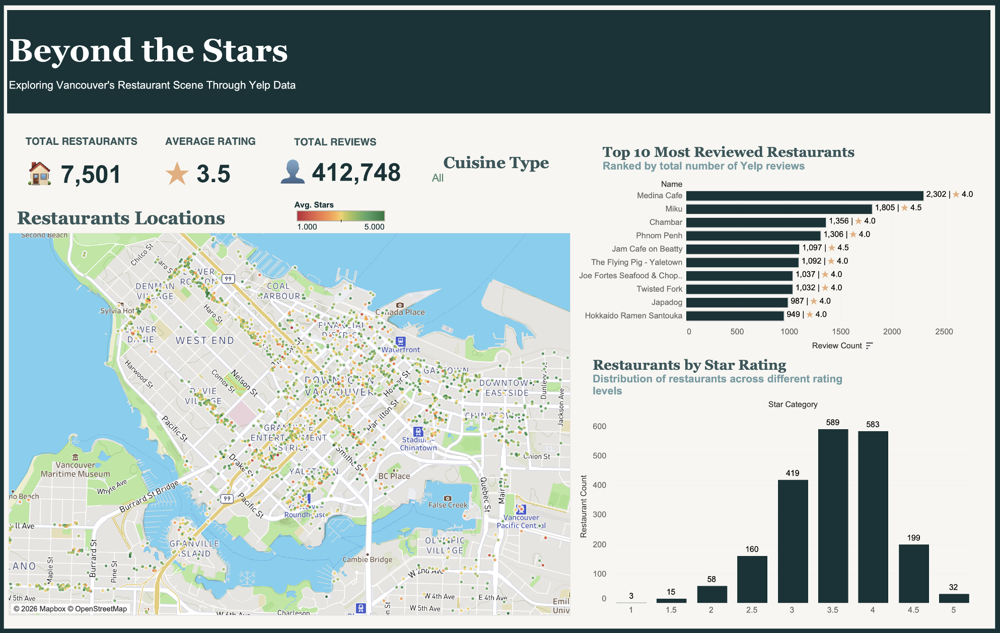
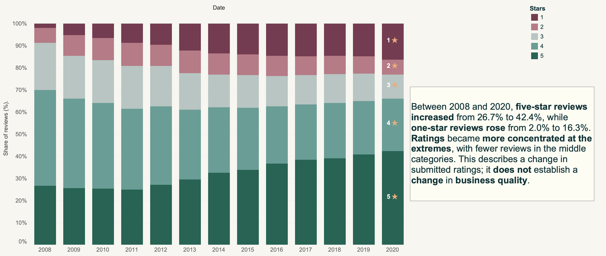
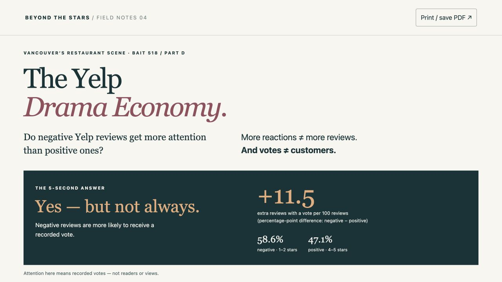

# Yelp Vancouver Analytics

**Beyond the Stars: restaurant ratings, review patterns and community reactions.**

An educational analytics project using historical Yelp data for Metro Vancouver. Built for BAIT 518 at UBC Sauder by **Arianna Falasca**, combining Tableau dashboards with an interactive web extension.

*Restaurant locations, cuisine filters and review-count rankings. The star-distribution panel follows the map viewport; the other panels use the broader eligible restaurant scope.*

## Questions and findings

| Question | Finding | Interpretation |
|---|---|---|
| How did submitted ratings change? | Five-star reviews rose from 26.7% in 2008 to 42.4% in 2020; one-star reviews rose from 2.0% to 16.3%. | Ratings became more concentrated at the extremes. This does not establish a change in business quality. |
| How concentrated is reviewer activity? | 8.8% of 138,375 users have more than 100 profile reviews and account for 71.8% of summed profile review counts. | A small group accounts for much of the reported profile activity. These totals are broader than the local restaurant-review table. |
| Do negative reviews receive more reactions? | Among 426,719 restaurant reviews, 58.6% of negative reviews received a vote, versus 47.1% of positive reviews: an 11.5 percentage-point gap. | The relationship reverses in the 2020 and partial-2021 review cohorts. Votes measure recorded reactions, not readership or sales. |

## Explore the project

- **[Beyond the Stars](tableau/Beyond%20the%20Stars.twb):** restaurant map, cuisine filters, KPIs, Top 10 most-reviewed restaurants and viewport-linked rating distribution.
- **[Yelp Reviews](tableau/Yelp%20Reviews.twb):** annual rating distributions, monthly review activity and user-profile contribution patterns.
- **[The Yelp Drama Economy](app/index.html):** filter reactions by review year, location, star rating and vote type. Download the repository and open `app/index.html` in a browser; it works offline. GitHub's HTML file view shows source code, not the running app.

Tableau Desktop is required. Download the full repository and run `python3 scripts/extract_data.py` to unpack [the included data](data/README.md), then open either workbook. See [Tableau setup and metric definitions](docs/TABLEAU.md).

## Visual previews

*Shares of submitted reviews within each year, using the supplied review table.*

*The web extension compares reaction rates and distinguishes pooled findings from annual patterns.*

## My contribution and AI use

I built the Tableau worksheets, dashboards and story, implemented calculated fields and filters, and refined the visual presentation with extensive ChatGPT guidance. AI supported planning, troubleshooting, interpretation and writing.

For the web extension, I selected the analytical question and requirements and directed revisions to the explanations and charts. ChatGPT Work implemented the app and initial data aggregation. Codex implemented the Python reproduction tools, automated checks and subsequent workbook refinements. These AI-generated components are included with explicit attribution. See [contribution and AI use](docs/AI-USE.md).

**Tools:** Tableau Desktop; HTML and JavaScript for the web extension; Python standard library for data reproduction.

## Data and reproduction

The course-provided historical subset contains **17,292 businesses, 622,690 reviews and 138,375 users**. The restaurant scope includes **7,501 businesses**; the extension uses **426,719 associated reviews**, from 2005 to January 2021.

The matching business, review and user JSON files are included in a compressed [four-part data archive](data/README.md), shared with course-instructor permission. Run `python3 scripts/extract_data.py` to use Tableau or [rebuild the aggregates and audit the findings](docs/REPRODUCE.md). The app uses embedded aggregates and works without extracting the archive. All 837 aggregate groups match the source-data calculations; see [data checks](docs/VALIDATION.md).

## Interpretation and limits

This is descriptive analysis of a historical course dataset. Votes are cumulative snapshot counts with no exposure data or vote timestamps. Review age, restaurant mix and reviewer behavior are uncontrolled. The 2021 observations cover only part of January. Findings do not establish causality, current restaurant quality or financial impact.

The restaurant selection uses normalized city labels, not a spatial boundary test. Profile review counts and counts in the local review table represent different populations. [Methods and definitions](docs/METHODS.md) explain these distinctions.

This independent educational project is not affiliated with or endorsed by Yelp. Data and third-party content remain subject to their original terms; no blanket reuse licence is granted by this repository.
